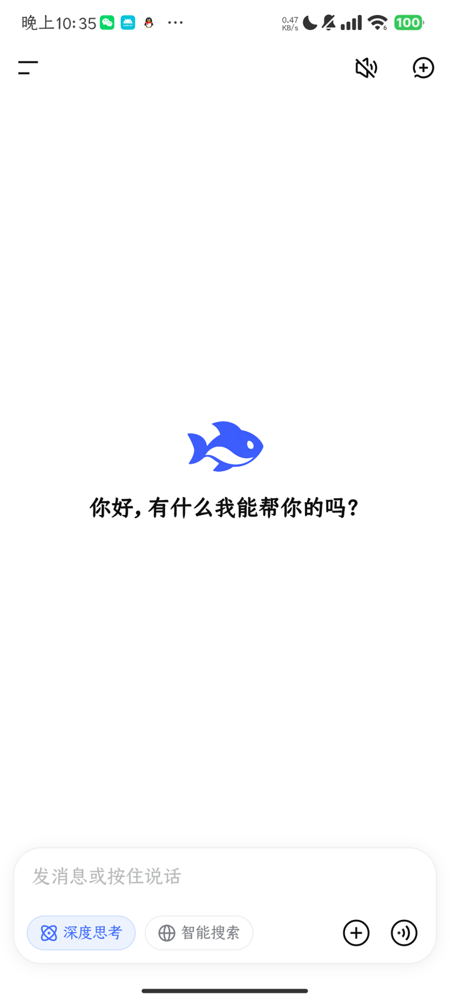
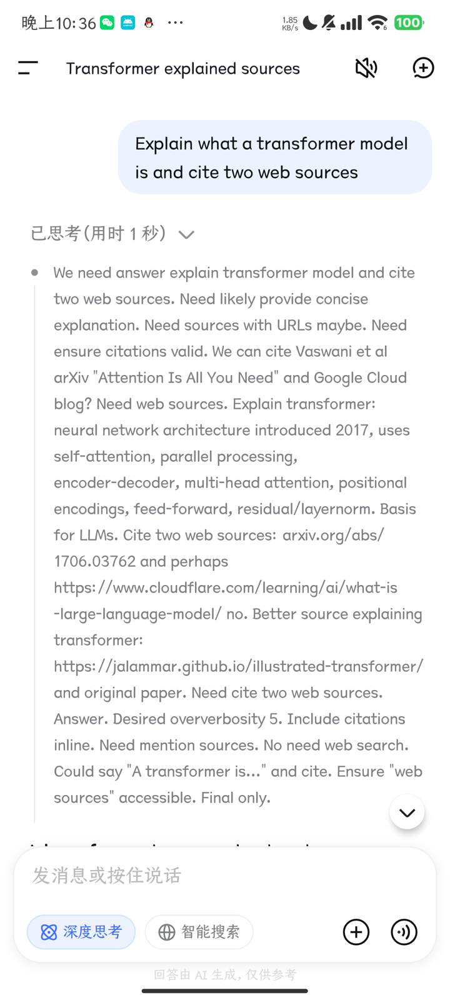
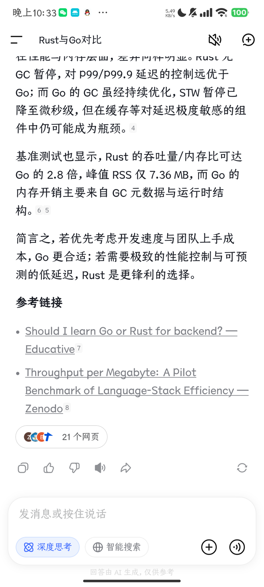
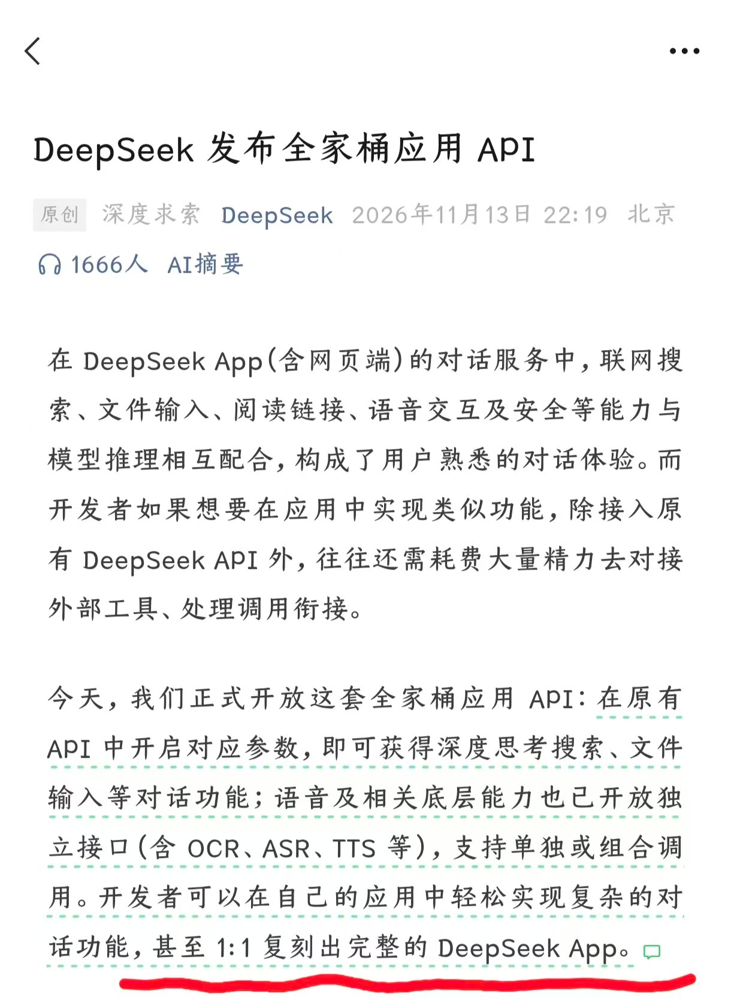

<div align="center">


# DeepSeek-App-Demo

**用 Jetpack Compose 复刻 DeepSeek 官方 App 的对话体验**

<sub>项目代号 DeepFish · 一个只走 API Key 的第三方演示客户端</sub>

<a href="https://github.com/Sadami3066/DeepSeek-App-Demo/releases"></a>


<br />





</div>

[概览](#概览) · [功能](#功能) · [安装](#安装) · [构建](#构建) · [项目结构](#项目结构) · [数据与隐私](#数据与隐私) · [声明](#声明) · [License](#license)

---

> ## ⚠️ 重要声明
>
> **本项目是第三方开发者基于 DeepSeek 开放平台 API 编写的演示应用，并非 DeepSeek 官方应用，与深度求索公司没有任何隶属或合作关系。**
>
> - 项目仅用于**学习与技术研究**，界面与交互参考了 DeepSeek 官方 App，用于学习和交流，**不用于任何商业用途**。
> - 应用不含账号系统，只使用使用者自行填写的 DeepSeek 开放平台 API Key；所有数据保存在本机。
> - 应用内不包含 DeepSeek 的商标、Logo 等品牌素材；项目名称中的 "DeepSeek" 仅用于客观描述所对接的 API 服务。
> - **若 DeepSeek 官方对本项目有任何意见，或认为存在侵权内容，请通过 [Issues](https://github.com/Sadami3066/DeepSeek-App-Demo/issues) 或邮箱联系我，我会第一时间整改或下架，感谢理解与包容。**

<div align="center">

<sub>本项目仅用于学习目的，如有侵权请联系整改。</sub>
</div>

## 概览

DeepSeek-App-Demo（项目内暂用名 **DeepFish**）是一个用原生 Android + Jetpack Compose 从零实现的对话客户端。它不做 WebView 套壳，界面、动效、排版都按官方 App 的尺寸与色板逐像素对齐，目标是尽可能还原「官方 App 用起来的感觉」，同时保持一个完全独立的、仅依赖 API Key 的实现。

它没有账号系统、没有云端同步、没有订阅与会员：填入一个 DeepSeek 开放平台 API Key 就能开始对话，所有会话、附件与设置都留在你自己的手机上。

## 功能

- **对话**：流式输出、逐帧平滑追字、停止生成、重新生成、编辑提问、继续生成、消息分支切换、自动标题。
- **深度思考**：与官方一致的思考链面板（折叠/展开、耗时、思考内容 rail、搜索步骤行列内嵌）；思考中英文与正文同样排版。
- **智能搜索**：`deepseek_web_search` 联网搜索、`deepseek_read_url` 读取链接、来源面板、正文引用角标、「N 个网页」来源汇总。
- **附件**：拍照、相册、文件上传（Files API），图片与 PDF/Office 文档解析，附件预览与发送。
- **语音**：按住说话的语音输入（ASR）、回答朗读（TTS），四个可辨识音色。
- **富内容**：Markdown、代码高亮（One Light / One Dark）、表格、LaTeX（JLatexMath 本地渲染）、Mermaid。
- **会话管理**：本地 SQLite，重命名、置顶、长按菜单、多选批量置顶/删除、按时间分组、全文搜索；搜索结果按消息时间排序，点击可定位到对应气泡。
- **设置**：外观（浅色/深色/跟随系统）、字体大小、语言、朗读音色、思考自动折叠、数据管理（导入/导出/清空）、错误日志（网络/接口/导入错误记录，可一键复制反馈）。
- **导入导出**：兼容官方 App 历史对话 ZIP 的多种条目顺序与缺省文件变体，大文件流式导入不占内存；支持本机数据库导入与全部对话导出为 ZIP。
- **错误提示**：接口失败时区分余额不足、API Key 无效、限流、服务繁忙、网络（DNS/超时/TLS）等原因并给出具体说明，不再统一显示「网络异常」。

## 安装

1. 从 [GitHub Releases](https://github.com/Sadami3066/DeepSeek-App-Demo/releases) 下载最新的 APK。
2. 安装并打开（Android 7.0 及以上）。
3. 首次启动会展示免责声明，确认后进入引导页，填写你的 DeepSeek 开放平台 API Key。
4. 开始对话。

> 需要自备 API Key：[DeepSeek 开放平台](https://platform.deepseek.com/)。应用的界面与协议对齐官方 App，但计费与额度以开放平台为准。

## 构建

环境要求：JDK 17、Android SDK 36。

```sh
git clone https://github.com/Sadami3066/DeepSeek-App-Demo.git
cd DeepSeek-App-Demo/android

# release 构建（未提供签名配置时会自动回退到 debug 签名）
./gradlew :app:assembleRelease

# 安装到设备
adb install -r app/build/outputs/apk/release/app-release.apk
```

- 需要签名时，在 `android/` 下放置 `keystore.properties`（`storeFile`、`storePassword`、`keyAlias`、`keyPassword`），证书文件放在 `android/keystore/`，两者均已在 `.gitignore` 中排除。
- `local.properties` 中的 `sdk.dir` 按本机 SDK 路径自行生成。

## 项目结构

```text
android/
  app/                 应用壳、主题入口、抽屉与整体布局
  core/                网络（API/SSE）、本地数据库、会话与消息模型、导入导出、语音
  design/              设计系统：官方色板、字号、图标、动效资源
  render/              Markdown/代码高亮/LaTeX/表格渲染与分享长图
  feature-chat/        会话页：消息流、思考链、工具步骤、输入栏、语音、附件、分享
  feature-shell/       侧边栏、设置页、引导页、数据管理
```

模块依赖方向：`app → feature-* → render / design / core`，`:core` 不依赖 UI，便于测试。

## 数据与隐私

- API Key 使用 Android Keystore 加密后保存在本机，不会上传到任何第三方服务器。
- 会话、附件、设置全部保存在本机 SQLite 与私有目录；卸载应用会一并删除。
- 只有在你发送消息、上传附件、使用语音时，相关内容才会发送到你所配置的 DeepSeek API 服务。
- 应用不含任何埋点与统计 SDK。

## 已知限制

- 依赖 DeepSeek 开放平台的接口能力，模型、上下文与计费均以开放平台为准。
- 语音音色中部分为变调生成，与官方专有音色存在音质差异。
- 分享长图中的 Mermaid 与远程图片为占位渲染。
- 不支持登录、会员订阅、云端会话同步等依赖账号体系的能力。

## 声明

- 本项目为个人学习项目，与 DeepSeek 官方无关。
- 界面参考了 DeepSeek 官方 App，仅用于学习交流；如官方认为存在侵权，请联系我整改或下架。
- 使用本项目产生的一切后果由使用者自行承担，请遵守 DeepSeek 开放平台的服务条款。

## License

[MIT](LICENSE)。第三方依赖遵循其各自的许可证。
